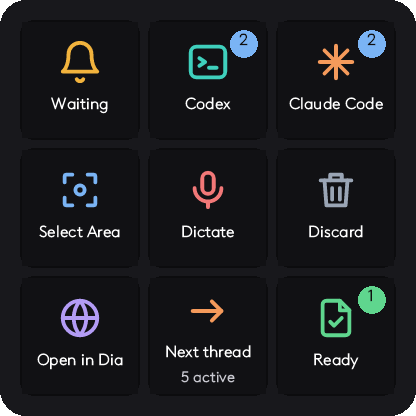

# MX Keypad for Claude Code and Codex

An agent skill and sample plugin for the Logitech MX Keypad (MX Creative Console) on macOS. The plugin turns the keypad's nine LCD keys into controls for Claude Code and Codex: which sessions are working, waiting or finished, one-press dictation, area screenshots, Send and Discard, and switching between active threads. It is built with the Logi Actions SDK. It records what worked on a real keypad and the failures that cost the most time, and it includes a complete sample plugin.



The Home screen as the full plugin draws it. The sample plugin below has a smaller Home page.

## Why install the skill

Writing a plugin for the MX Keypad takes days of trial and error, because Logitech's documentation is thin and partly wrong for the current software. The skill gives your coding agent what that took to learn, and it fits the keypad to the tools you already use, so you do not have to copy someone else's setup.

When you ask your agent to build a keypad plugin, the skill makes it:

- **Look at your Mac.** It lists the coding agents, dictation app, screenshot tool, browser and terminal you have installed. It opens no settings file and no credential.
- **Ask a few short questions.** Each comes with a recommended answer, for example how you start dictation and which three actions you repeat most. Answering "yes" accepts the recommendations.
- **Show the plan first.** It tells you which keys it will build and which it will leave out, with the reason, and waits for your reply.
- **Build from a working plugin.** It changes only the parts that depend on your tools: the agent apps, the dictation app and its trigger, the screenshot shortcut, the browser and the usage limits.
- **Avoid the failures that cost the most time.** More than twenty are recorded, such as keys that go blank after an icon template is added, a Return that lands in the wrong session, and a dictation that never reaches the message box.

Claude Code and Codex are tested on a real keypad. For other agents, such as OpenCode, pi or Gemini CLI, the skill asks the same six questions about each one and builds from the answers. Those agents are not tested yet.

## Install

```bash
npx skills add Shivak11/mx-keypad-claude-code-codex
```

The skill is in [`skills/mx-keypad-claude-code-codex`](skills/mx-keypad-claude-code-codex/SKILL.md). Your agent loads it when you ask about the MX Keypad, Logi Options+ plugins, Logi Plugin Service or physical buttons for coding agents.

## What the skill covers

- Learning which coding agents, dictation app, screenshot tool and browser you use, asking what you want, and building only the keys that fit
- Setting up a plugin on the .NET version the Logi Plugin Service actually runs (.NET 10 on service 6.4, not the .NET 8 the docs name)
- Drawing every key yourself: the icon template that removes Options+ captions, colour SVG icons, one label size, press feedback
- Screens, lists, More, Back and Home, and switching Options+ pages
- Showing which Claude Code and Codex sessions are working, waiting or finished, using lifecycle hooks that never store prompt text
- Opening the exact session, and opening the page from each app's built-in browser panel in another browser
- Putting dictation and screenshots into the last AI window's message box, with a check that the window is in front; the user presses Enter
- Sending each result to the text box that had the cursor when the key was pressed, by remembering that box and restoring focus to it through the accessibility API
- Switching between the threads in use, most recent first, like switching tabs
- Reading Claude and Codex five-hour and weekly usage limits without getting rate limited
- Proving changes without touching the device: rendering keys to PNG and running probes inside the plugin

## Sample plugin

[`sample-plugin`](sample-plugin) holds **Agent Keypad**, a working plugin with two pages:

- **Home:** Waiting, Codex, Claude Code, Select Area, Dictate, Cancel, Open in Dia, a key that switches between Claude and Codex, and Ready.
- **Moves:** Save note, Usage, Clipboard (disabled), Screenshot, Emojis, Downloads, Projects, Back and Home.

It expects Claude desktop, Codex desktop, the Doing dictation app with fn as its trigger, and the Dia browser. Change the bundle ids and shortcuts in `KeypadController.cs` and `CaptureController.cs` for your own apps.

```bash
cd sample-plugin/plugin/AgentKeypadPlugin/src
dotnet build -c Debug                 # needs the .NET 10 SDK; installs a link to the build and reloads the plugin
python3 ../../../hooks/install_hooks.py   # adds session hooks to Claude Code and Codex (backs up both files)
```

Then, in Logi Options+, turn off Adapt to App for the MX Keypad, drag Home key 1 to 9 onto the first page and Moves key 1 to 9 onto the second, and give Logi Plugin Service Accessibility and Screen Recording permission.

The plugin reads your Claude Code login from the macOS Keychain to fetch Claude usage limits from Anthropic. The login is used only for that request and is never stored or logged.

## Licence

MIT
